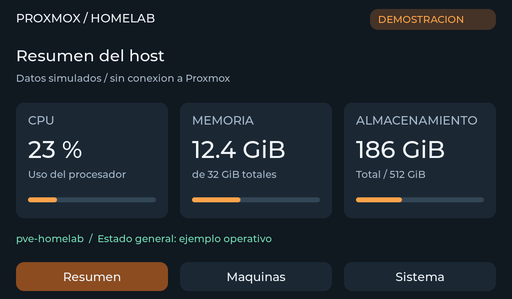
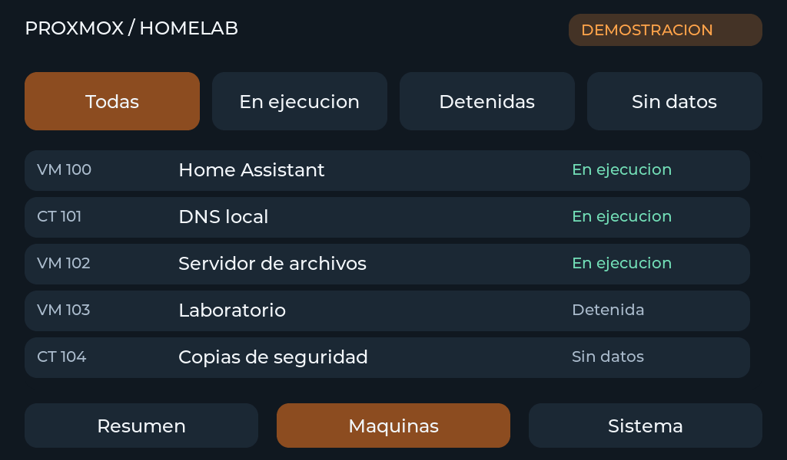
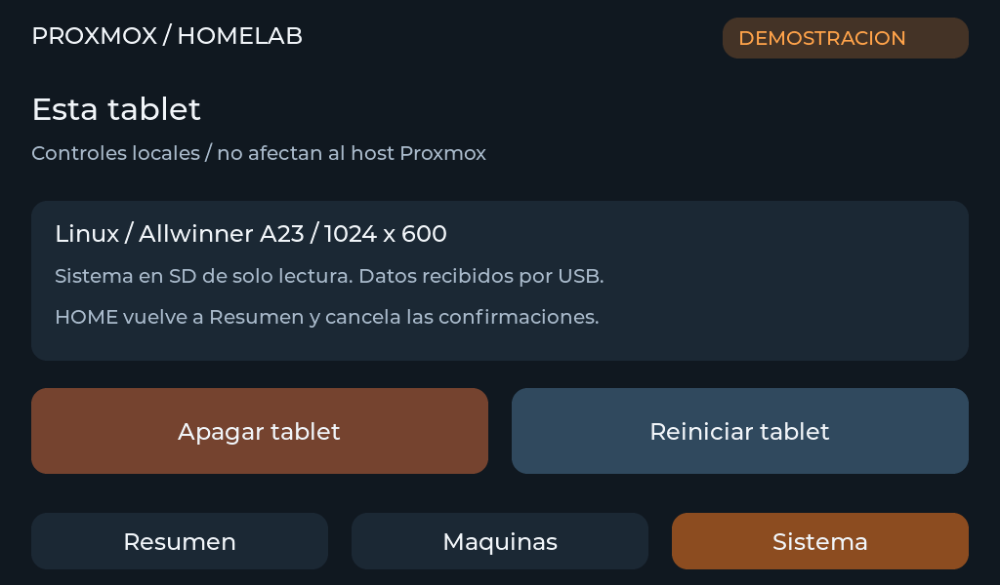

# Tablet Proxmox Panel

An archived personal project: a touchscreen Proxmox dashboard for a Eurocase
EUTB_710MDQ repurposed to run Linux from microSD. This repository's purpose is
to preserve the application and explain what it does. It is not a general-purpose
Proxmox management product or a portable one-command installer.

## What it does

The summary shows host CPU, RAM and one explicitly selected storage. A scrollable
machine list shows VM/container names and running/stopped/unknown states, with
filters that preserve the selection and scroll position during updates. The
system page controls shutdown/restart of the tablet itself. It does not control
the Proxmox host or its guests. Home returns to the summary.

A Python collector runs on the Proxmox host, reads its local HTTPS API using
read-only audit permissions and sends snapshots over USB. The tablet runs a
C/LVGL application that validates and renders the data. API credentials stay on
the host. Missing data, stale samples and API errors have distinct handling;
a failed query is not displayed as stopped guests or measured zeros.

```text
Local Proxmox HTTPS API -> Python collector -> USB ACM data -> LVGL tablet UI
```

## Screenshots

These are software-rendered previews from the v5 application using demonstration
data, not photographs or captures of the owner's live host inventory. The
original UI labels are Spanish; this English README preserves the application
as it was built.

### Host summary



### Machine list



### Tablet controls



## What is preserved

- `panel.c`, `lv_conf.h`: LVGL application and display/input configuration.
- `protocol.c`, `protocol.h`, `vendor/`: validated JSON receiver and cJSON.
- `collector.py`, `transport.py`: Proxmox reads, USB discovery and reconnect.
- `send-demo.py`, `demo.json`: demonstration sender and data.
- `test-*.py`, `test-protocol.c`: existing collector, transport and parser tests.
- `tablet-panel.service`, `99-tablet-panel.rules`: original host integration.
- `Makefile`, `build-arm.sh`, `prepare-image.sh`: original build/packaging tools.

The installed v5 image was booted from SD and tested with real data, filters,
scrolling, Home and UI restart with automatic data recovery. The collector also
recovers when the tablet becomes available again; it sends the current snapshot
rather than replaying a history of samples.

## Reuse limitations

The original scripts assume paths and Docker build artifacts from the tablet
firmware workspace. `install-host.py` targets a host named `pve`, node `pve` and
storage `local-lvm`; it creates an account, API permissions, configuration and a
persistent systemd service. Read and adapt it before reuse. It is not a generic
installer. The archived build uses LVGL 9.4.0 and retains third-party licenses.

The USB gadget provides separate console and metrics functions. Do not send JSON
to the debug shell or start two senders on the data endpoint. The collector uses
the local Proxmox API; remote API collection is not implemented.

Firmware research, board support and reproduction instructions belong to the
separate tablet Linux project. The exact final public repository link will be
added after that repository exists. This application does not require further
feature work or UI translation to serve as a historical archive.
